# Defining Your Users in Okta — IAM Lab 01


First lab in my **Identity & Access Management (IAM)** journey. I built and managed a user identity end to end in the **Okta Admin Console**. I extended the user profile schema, onboarded a new hire, worked through the account issues a help desk sees every day (forgotten password, suspected credential exposure, lockout), and offboarded the user under a 30-day policy.

> **Core takeaway:** defining users is the foundation of security. Every access decision that follows depends on knowing exactly *who is who*. That means building each account from an accurate identity profile and managing it across its whole lifecycle.

---

## At a glance

| | |
|---|---|
| **Platform** | Okta Admin Console (trial org) — Universal Directory, Profile Editor, People, System Log |
| **Date** | November 12, 2026 |
| **Labs completed** | 3: Add a custom attribute · Create users · Manage user account statuses |
| **Case scenarios** | 6, written up with the STAR method below |
| **Account statuses exercised** | 7: Pending user action → Active → Password reset → Password expired → Locked out → Suspended → Deactivated |
| **Audit evidence** | 4 `user.lifecycle` events in the System Log, all `SUCCESS` |

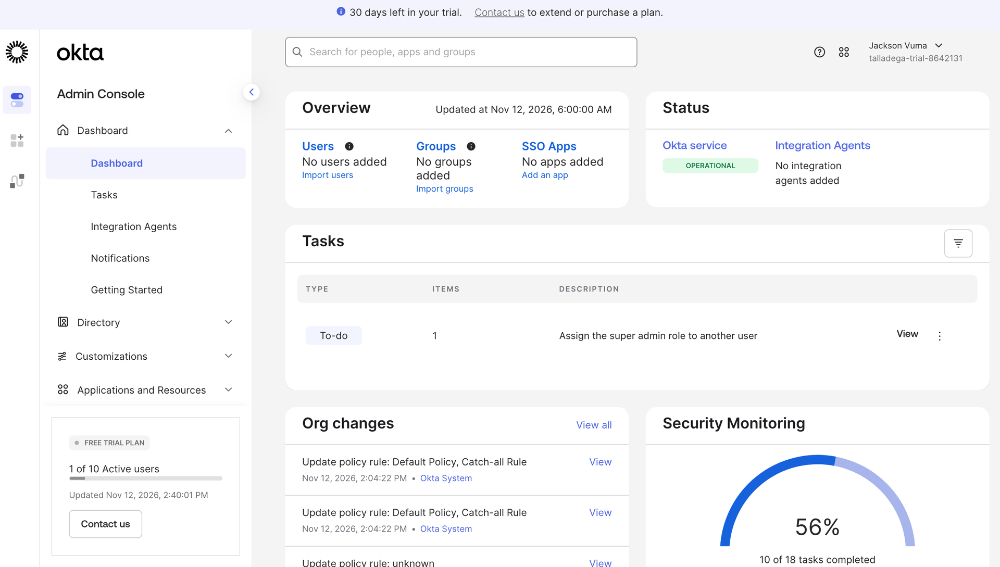
*Starting point: a fresh org with 1 admin user, no groups and no apps.*

---

## Identity lifecycle I exercised

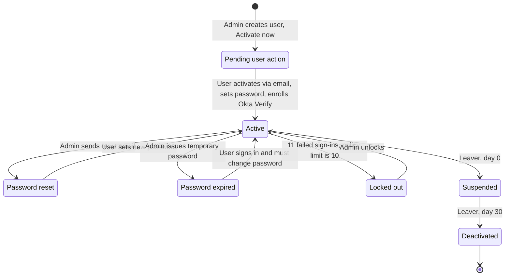

| Admin Console status | API status | What triggered it | Can sign in? |
|---|---|---|---|
| Pending user action | `PROVISIONED` | User created and activated, no password set yet | No, until the activation email is used |
| Active | `ACTIVE` | User completed activation | Yes |
| Password reset | `RECOVERY` | Admin sent a reset-password email | Only through the reset link |
| Password expired | `PASSWORD_EXPIRED` | Admin issued a temporary password | Yes, but must change it immediately |
| Locked out | `LOCKED_OUT` | Failed sign-ins exceeded the policy limit | No |
| Suspended | `SUSPENDED` | Admin suspended a leaver | No (app and group assignments kept) |
| Deactivated | `DEPROVISIONED` | Admin deactivated after 30 days | No (app assignments and admin roles removed) |

---

## Case scenarios (STAR)

### 1. Extend the identity profile with a governed "Region" attribute

| | |
|---|---|
| **Situation** | The organization needs to know which geographic region each user belongs to. The default Okta user profile has no field for it. |
| **Task** | Add a region attribute to every user profile, restricted to valid values, that users can't change themselves. |
| **Action** | Went to **Directory → Profile Editor → Okta User (default) → Add Attribute**. Set data type `string`, display name **Region**, variable name `region`, description "Geographic region". Defined an **enumerated list** of `AMER` / `APAC` / `EMEA`, set user permission to **Read Only**, and saved. |
| **Result** | Every identity now carries a region limited to **3 valid values**: no free-text typos, and only admins can set it. That makes it reliable input for group rules, access policies and reporting. |

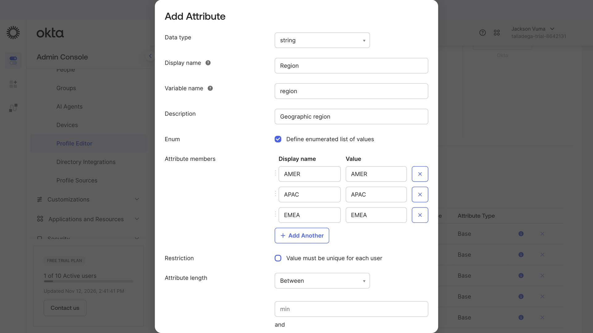

---

### 2. Joiner: onboard a new hire (Nina Shah)

| | |
|---|---|
| **Situation** | New hire Nina Shah (IT Admin, Org1) needs an Okta account before her first day. |
| **Task** | Create her identity, enrich her profile, and get her to **Active** without the admin ever knowing her password. |
| **Action** | **Directory → People → Add Person** with username `nina.shah@org1.com`, *Activate now*, and **"I will set password" left unchecked** so Okta emails her an activation link instead. Confirmed the status was **Pending user action**. Filled in **7 profile attributes**: Title *IT Admin*, Primary phone, User type *Employee*, Cost center *IT*, Organization *Org1*, Department *IT*, Region *AMER*. As Nina, opened the *Welcome to Okta* email (link valid 7 days), set a password and enrolled **Okta Verify** MFA. Back in the admin account, confirmed **Active**, then checked **Reports → System Log** with `eventType sw "user.lifecycle"`. |
| **Result** | Account **Active with MFA enrolled**, and the admin never handled the credential. The System Log recorded **Create Okta user** and **Activate Okta user** (both `SUCCESS`) with the admin as actor: an auditable record of who provisioned whom, and when. |

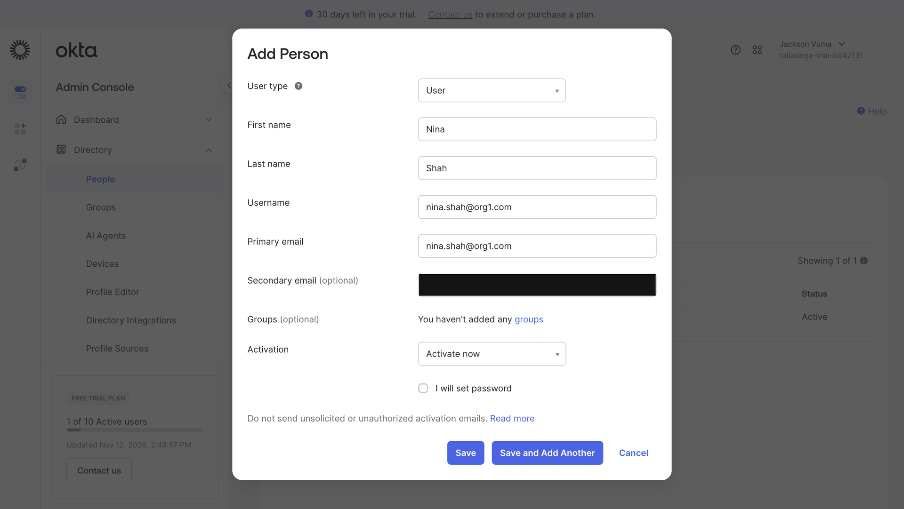

<details>
<summary><b>More screenshots: pending status, activation email, System Log</b></summary>

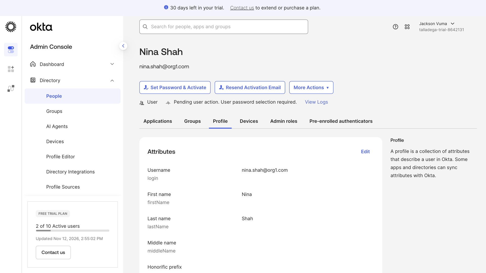
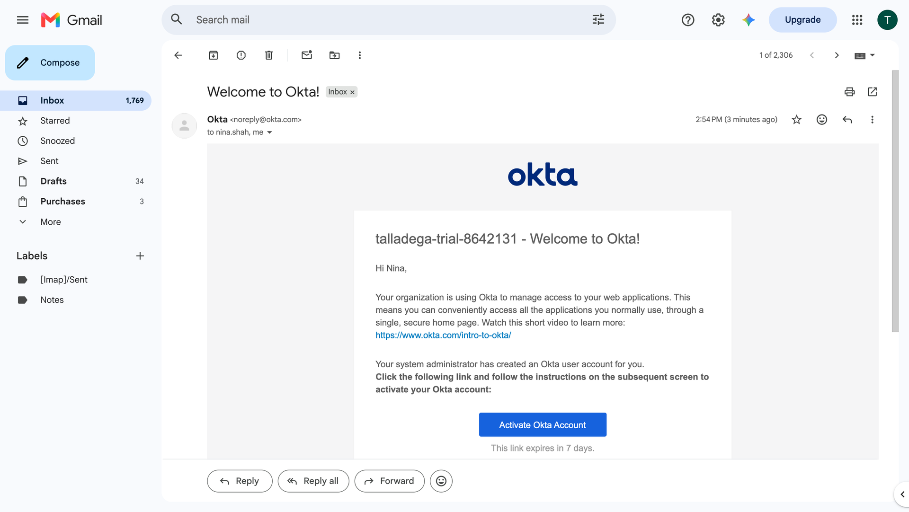
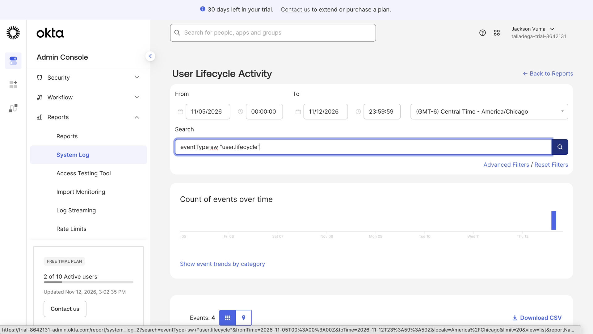
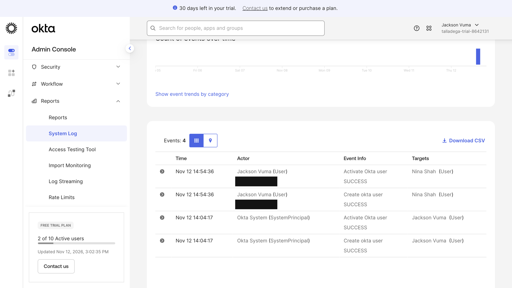

</details>

> **Gotcha:** the event-type prefix is `user.lifecycle`. A misspelled prefix quietly returns zero events, which can look like nothing happened.

---

### 3. Forgotten password: user-driven reset by email

| | |
|---|---|
| **Situation** | Nina forgot her password and can't sign in. |
| **Task** | Restore access without the admin setting or seeing her new password. |
| **Action** | On Nina's account: **Reset or Remove password → Send a reset password email**, with **Sign out user** checked to end sessions on all devices and browsers. Confirmed the status was **Password reset**. As Nina, used the emailed link (expires in **1 hour**) to set a new password, then confirmed **Active**. |
| **Result** | Access restored in one cycle. All existing sessions were terminated, and only the user knows the new credential. |

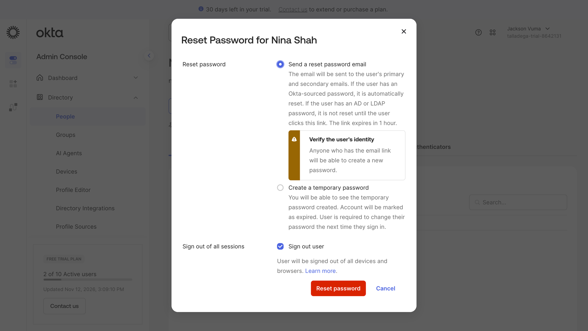
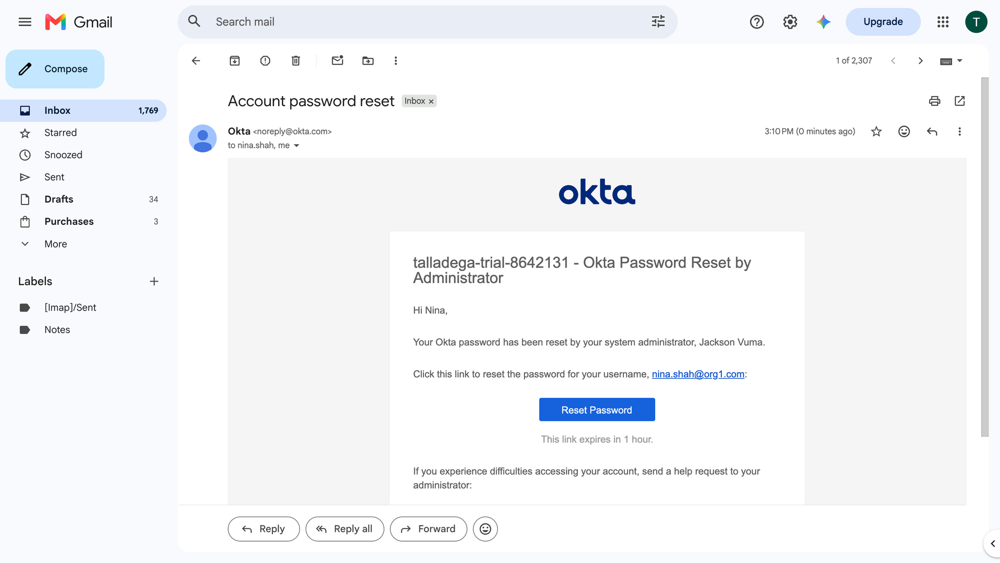

---

### 4. Suspected credential exposure: expire the password

| | |
|---|---|
| **Situation** | Nina's password may have been exposed. |
| **Task** | Make the possibly compromised password useless right away and force her to choose a new one. |
| **Action** | **Reset or Remove password → Create a temporary password**, with **Sign out user** checked. Confirmed the status was **Password expired**. In an incognito window, signed in as `nina.shah` with the temporary password, was forced to set a new one, then confirmed **Active**. |
| **Result** | One admin action invalidated the exposed credential, revoked every live session, and forced a password change at next sign-in. |

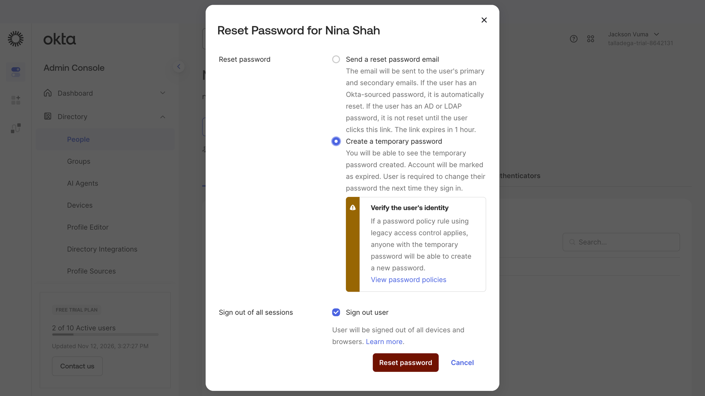

> Okta's own dialog warns: **verify the user's identity** first, because anyone holding the temporary password can set a new one. Send it out-of-band, never in the same channel the request came from.

---

### 5. Account lockout: brute-force control in action

| | |
|---|---|
| **Situation** | Nina entered the wrong password 11 times. |
| **Task** | Confirm the lockout control fired, then restore legitimate access. |
| **Action** | Simulated **11 failed sign-ins**; the default password policy locks the account after **10**. Saw **Locked out** on the People list, unlocked the account from Nina's profile, and confirmed **Active**. |
| **Result** | Confirmed the password policy stops password guessing at 10 attempts, and restored access with one admin action. |

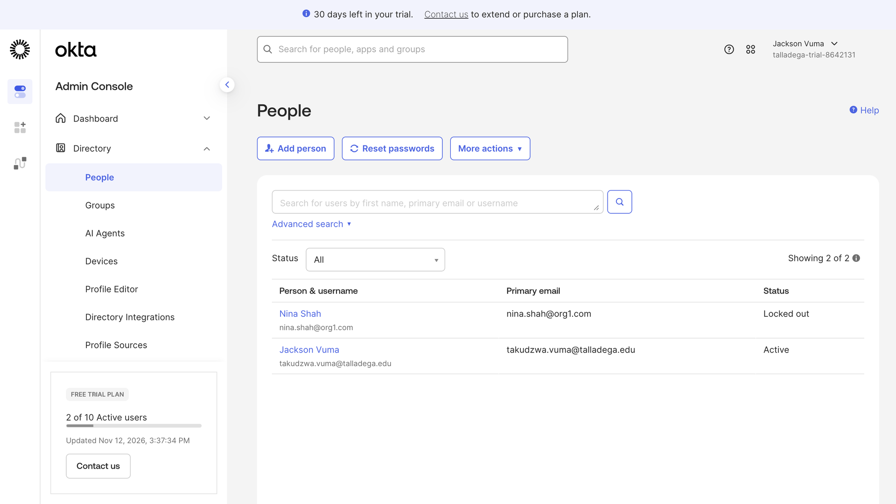

> In production, treat a lockout as a possible attack, not just a forgetful user. Check the System Log for source IPs and verify identity before unlocking.

---

### 6. Leaver: suspend on day 0, deactivate on day 30

| | |
|---|---|
| **Situation** | Nina left the company. Policy says suspend immediately so she can't reach Okta or her apps, then deactivate after 30 days. |
| **Task** | Cut off access the moment she leaves, keep a reversible window, then fully deprovision on schedule. |
| **Action** | **More Actions → Suspend**, confirmed **Suspended**, and checked that sign-in as Nina was blocked. Then, simulating day 30, **More Actions → Deactivate** and confirmed **Deactivated**. |
| **Result** | **Zero Okta access from day 0**, with app and group assignments kept for review or rehire. At day 30, deactivation revoked her app assignments and admin roles, and the account became eligible for permanent deletion. |

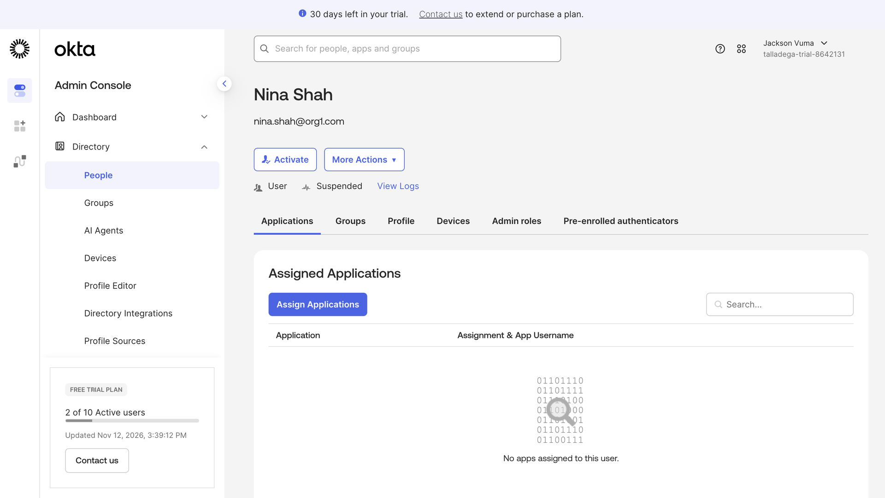

> **Suspend vs. deactivate:** suspension blocks Okta sign-in and kills sessions but keeps assignments, and it's reversible with *Unsuspend*. A suspended user may still reach downstream apps that allow direct (non-SSO) login. That's one reason to deactivate on schedule and enforce SSO everywhere.

---

## Results

- **3 labs · 6 scenarios · 7 account statuses** worked through end to end
- **1 custom schema attribute** with **3 enumerated values**, and **7 profile attributes** set on a new identity
- **Joiner and leaver** workflows completed, with MFA (Okta Verify) enrolled at activation
- **3 help-desk scenarios** handled: forgotten password, suspected compromise, lockout
- **4 lifecycle events** confirmed in the System Log as audit evidence
- Policies observed: **lockout at 10 failed attempts**, **1-hour** reset link, **7-day** activation link, **30-day** leaver deactivation

## Key takeaways

1. **Identity data drives access.** Governed attributes (enumerated values, read-only for users) keep profiles trustworthy enough to base policies on.
2. **Admins shouldn't know user passwords.** Activation emails and reset emails keep the credential with the user.
3. **Match the reset method to the threat.** Use an email reset for a forgotten password. Use a temporary password plus session sign-out for a suspected compromise.
4. **Help-desk resets and unlocks are a social-engineering target.** Verify identity before acting.
5. **Suspend and deactivate do different jobs.** Suspend is immediate and reversible; deactivate removes access and app assignments.
6. **The System Log is the evidence.** Every lifecycle change is recorded with actor, target, time and outcome.

## Skills demonstrated

`Okta Admin Console` `Universal Directory` `Profile Editor` `Custom attributes / schema extension` `User provisioning` `Joiner & leaver workflows` `Account lifecycle management` `Password reset` `Credential compromise response` `Session revocation` `Account lockout remediation` `MFA enrollment (Okta Verify)` `Offboarding & deprovisioning` `System Log auditing` `Screenshot redaction`

## Up next

- **Lab 02: attribute mappings.** Map Okta user attributes to Okta Workflows, using Okta Expression Language for role mapping, and compare *create only* vs. *create and update* sync behavior.
- **Open item from the dashboard:** *"Assign the super admin role to another user."* A second super admin (break-glass account) avoids a single point of failure for admin access.

## Repository structure

```
defining-your-users/
├── README.md
└── screenshots/
    ├── 01-admin-console-dashboard.png
    ├── 02-custom-attribute-region.png
    ├── 03-create-user-nina-shah.png
    ├── 04-pending-user-action-profile.png
    ├── 05-welcome-activation-email.png
    ├── 06-user-lifecycle-system-log-query.png
    ├── 07-user-lifecycle-events.png
    ├── 08-reset-password-email-option.png
    ├── 09-password-reset-email-received.png
    ├── 10-temporary-password-expire.png
    ├── 11-account-locked-out.png
    └── 12-account-suspended.png
```

---

**Notes:** This is a hands-on write-up based on Okta's *Define Your Users in Okta* lab guide (v2026.03); the guide itself isn't redistributed here. Nina Shah and `org1.com` are fictitious lab data. Personal email addresses and IP addresses are blacked out in the screenshots, and browser tabs are cropped out.

**Author:** Jackson T. Vuma · B.A. Computer Information Systems (IAM, Cloud & AI Security), Talladega College
